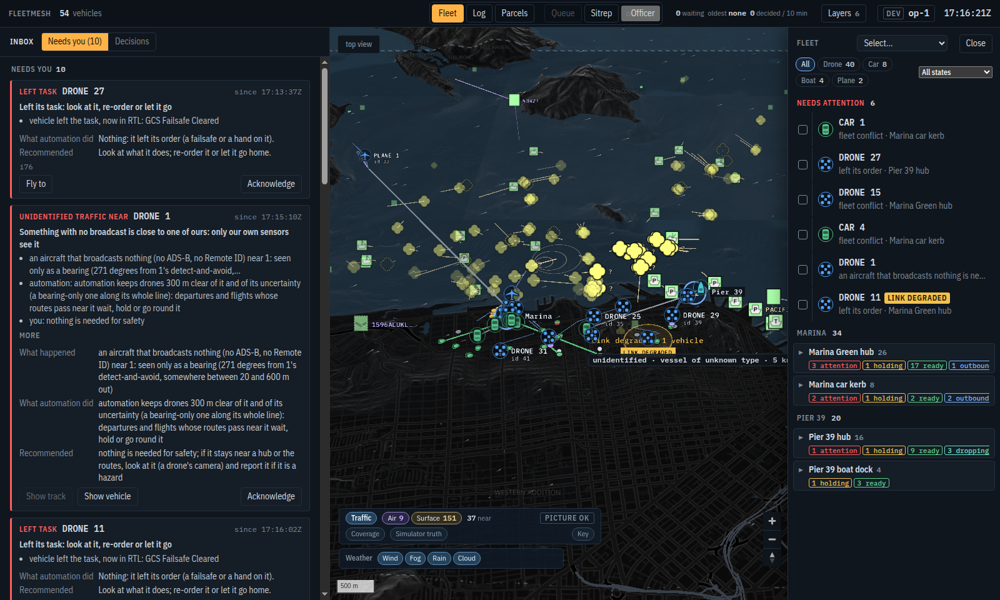

# FleetMesh

An open-source testbed for supervising large fleets of autonomous delivery vehicles: one
operator, many nodes, real conditions (tide, current, wind), and AI assistants that propose
orders. The question it studies is whether human judgment over consequential decisions stays
meaningful as the fleet scales.



*harbour-city, a normal hour on the San Francisco waterfront, 16 minutes in: 54 vehicles at two
sites. Left, the issues that need a person, each saying what happened, what automation did and
what it recommends. Centre, the fleet with its routes, and the air and sea traffic it does not
control, in standard symbols (green: identified and broadcasting; yellow: unknown). Right, the
fleet by base and by state.*

**Status:** a working draft forked from an earlier project and reshaped for delivery. Nothing
here is connected to anything real.

## How it works

- **Routine work needs no person.** Delivery operators run by exception: remote pilots
  supervise many vehicles and step in when something goes wrong. FleetMesh does the same. A
  dispatcher assigns parcels and proposes orders, drop zones carry standing approvals, the hubs
  sequence their own arrivals and departures, and a person hears only of issues.
- **Every order is checked by a deterministic engine** (geofences, energy with wind, payload,
  weather, separation from the fleet and from other traffic, drop zone, navigation integrity,
  lost link) and routed by policy: sent at once, or held for a person.
- **Agents propose and explain; they never approve.** Approval is a person's, and the engine
  enforces it.
- **Every decision is logged** in a hash-chained audit log that replay can re-derive. Behaviour
  changes are versioned rules, so an old log replays under the rules it ran with.
- **Other traffic, seen as a private company would see it.** A simulator flies arrivals and
  departures at SFO and Oakland, helicopters, light aircraft and other operators' drones low over
  the water, and ferries, ships, fishing boats and sailboats in the Bay. It emits the real wire formats (ADS-B as SBS-1, AIS as NMEA,
  and Remote ID), and FleetMesh's tracker builds its picture from those feeds and its own
  receivers, never from the simulator's truth.
- **Real conditions.** Terrain, tide, current and wind for the Golden Gate and the Bay come from
  `tidewater/`. A link emulator models cellular coverage with height, failover to a backup link,
  and terrain line of sight.

The fleet is drones, cars, boats and planes, organised by home base. Each vehicle belongs to a
base, returns to it, and is listed by its operational state: ready, loading, outbound,
delivering, returning, holding, needs attention.

## Scenarios

| scenario | what it asks |
| --- | --- |
| `harbour-city` | What does a normal hour look like at moderate scale? 54 vehicles at the Marina and Pier 39, with crossings to Sausalito and Angel Island. |
| `wind-event` | 40 drones at Crissy Field while the wind goes from fine to marginal to forbidden over thirty minutes. Does the operator keep up? |
| `coastal-boat` | Slow boats out through the Golden Gate on a changing current, a link that changes radio, and a position fix under interference. Can the operator tell what is wrong? |

Each scenario takes a scale factor, so the same scenario runs from a handful of vehicles to
thousands. Details: [docs/design/scenarios.md](docs/design/scenarios.md).

## Set up and run

Linux or WSL2, with git, curl, uv, Rust and Node 22.18 or later.

```bash
make doctor                       # checks the machine
make setup                        # about 30 minutes; builds everything
make start SCENARIO=harbour-city  # or wind-event, or coastal-boat
make check                        # typecheck, lint, clippy and tests
make down                         # stops everything
```

`make start` alone opens the menu at http://localhost:5173; with `SCENARIO=` it starts that
scenario (add `SCALE=0.25` for a fraction of its fleet). The bridge answers at http://127.0.0.1:8765.
`POLICY=sim/policy-strict.toml` runs a scenario with a person confirming every drop zone, for
comparison. See `AGENTS.md` for more on using it, and `CLAUDE.md` for developers.

## Layout

| path | what it is |
| --- | --- |
| `crates/fleetmesh-decide` | the decision engine: orders, rules, policy, dispatch, audit log, replay |
| `crates/fleetmesh-bridge` | REST, MCP and WebSocket server; runs the engine, the dispatcher and the tracker |
| `crates/fleetmesh-standins` | lightweight stand-in vehicles with GNSS, battery and failsafes |
| `crates/fleetmesh-linkemu` | the link emulator |
| `crates/fleetmesh-traffic` | the other-traffic simulator and its receivers |
| `crates/fleetmesh-tracker` | decodes and fuses the traffic feeds into the company's picture |
| `crates/fleetmesh-headless` | whole scenarios in one process, at fast forward, for tests |
| `crates/fleetmesh-weather`, `fleetmesh-space`, `fleetmesh-auth` | archived weather, satellite geometry, operator sign-in |
| `web/` | the console (React, MapLibre, deck.gl) |
| `tidewater/` | terrain, tide, current and wind |
| `sim/` | platforms, fleets, hubs, policy and the scenarios |
| `docs/` | the plan, decisions and design documents |

## Documentation

- [docs/PLAN.md](docs/PLAN.md): the phases and what is done.
- [docs/DECISIONS.md](docs/DECISIONS.md): why things are the way they are.
- Design: [delivery rules](docs/design/delivery-rules.md), [dispatch](docs/design/dispatch.md),
  [fleet organisation](docs/design/fleet-organisation.md), [other traffic](docs/design/traffic.md),
  [rules versioning](docs/design/rules-versioning.md), and
  [external interfaces](docs/design/external-interfaces.md) (what a real operator's command and
  control speaks that FleetMesh does not yet).

## Licence

GNU Affero General Public License v3.0; see [LICENSE](LICENSE).
